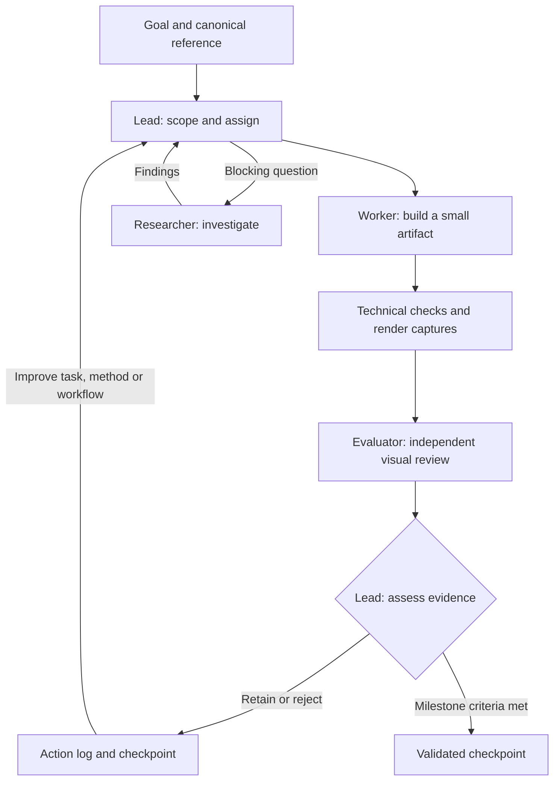

# The ocean — an agentic systems experiment

The main purpose of this project is to build an agentic system with evaluation and feedback loops built in, so it can learn from its results and improve how it works. Generating an ocean inspired by Hokusai’s *The Great Wave* is the test case: a concrete visual problem that exposes weak reasoning, repeated failures and gaps between passing tests and convincing output.

## Agent architecture

A lead coordinates a **worker** for implementation, an independent **evaluator** for visual review, and an optional **researcher** for blocking questions. At most two agents run under the lead, with one source writer.



The loop records failures, compares results with explicit criteria, and changes the next task or method. Repeated failures should trigger a different approach rather than more nearby tweaks. Technical correctness and artistic quality are evaluated separately.

Today, this learning is **lead-managed** through recorded findings and updates to tasks and workflow rules. Reliable autonomous self-improvement is still the goal. See the [agent workflow](agents/wave-completion.md) and [action log](research/agent-iteration-log.md).

## The visual test case

- **Appearance:** Hokusai’s original woodblock print, using the [Metropolitan Museum scan](references/great-wave-off-kanagawa-met-DP130155.jpg) as the canonical reference.
- **Construction:** [LingDong-’s Shan, Shui](https://github.com/LingDong-/shan-shui-inf), which builds objects from generative rules before rendering their contours and details.

The intended result is a varied, endlessly explorable ocean with recognizable Great Wave anatomy. Seeded generation makes revisits reproducible.

## Pivots

- **Braille dots → woodblock color:** complete water surfaces, ivory foam, indigo contours and pale clouds.
- **Painted sprites → generated geometry:** construct profiles and branching foam instead of reusing finished waves.
- **Detail tuning → anatomy and evaluation first:** prove small visible improvements before adding texture or expanding scope.

## Current progress

The [procedural gallery](research/woodblock/generated-gallery.html) generates reproducible wave collections. Fifteen geometry/model tests pass, and one foam attachment passed local visual review across six seeds.

The evaluation loop has also rejected a two-group experiment whose upper branch resembles a prong. The artwork remains unfinished: foam anatomy, contour variation and broader wave families need work before a continuous procedural ocean. The root page retains an earlier painted prototype.

## Run locally

No build or package installation is required:

```sh
python3 -m http.server 4187 --bind 127.0.0.1
```

Open the [generated wave gallery](http://127.0.0.1:4187/research/woodblock/generated-gallery.html).
