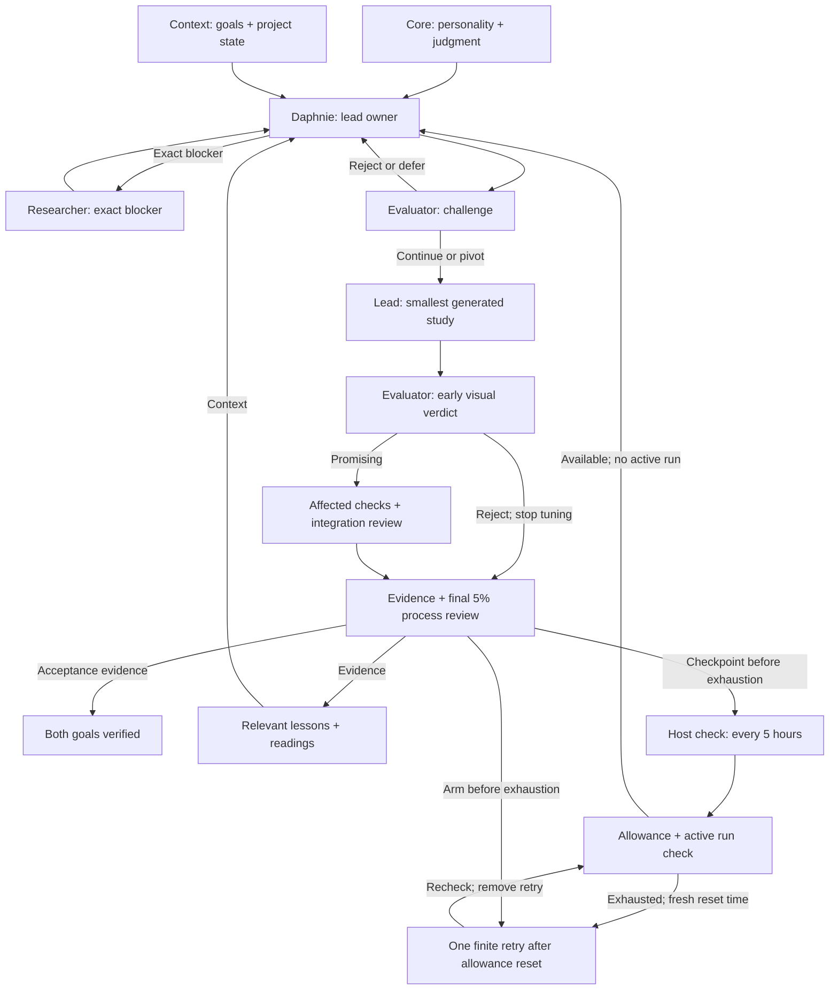

# The ocean — procedural art and agentic systems

<!-- goals:start -->
Both project goals have equal priority.

- **ART: Procedural Great Wave ocean.** Create a visually recognizable Great Wave ocean in the canonical Hokusai woodblock language, using LingDong-style mathematical construction and continuous generation.
- **SYSTEM: Efficient evaluated agentic development.** Develop a small agentic system that reaches the artwork goal through critical thinking, external learning and fast, high-quality experiments with few resources.

[Full goals and acceptance criteria](GOALS.md). Progress status does not establish visual acceptance.
<!-- goals:end -->

## Agent architecture

Daphnie, the lead, owns delivery, decisions and documentation. Her personality and judgment are separate from project goals and context. Strategy and visual review use the existing independent evaluator; a worker handles defined patches and a researcher resolves exact blockers. One child runs at a time.

<!-- architecture:start -->
<!-- Reviewed architecture inputs: b87f686d0e4c26600017367b7c375293f313a2172b1c808dddbb4c6a5a9c6d8f -->

<!-- architecture:end -->

Before building a new hypothesis, an independent strategy review checks supporting and contrary evidence, predicts an observable result, and sets one bounded test with a source-backed construction relationship. It can retain a sound path, pivot, reject a construction, or defer judgment when evidence is missing. A deterministic gate checks the record and evidence; it cannot guarantee good judgment.

Every phase reserves **5% of its planned token budget** for reviewing process and logs before another phase starts. A short brief, evidence-linked lessons and structured phase records carry findings forward. Technical correctness and artistic quality are evaluated separately. Exact compute telemetry is unavailable here, so usage estimates remain explicit.

Owner-authorized local checks are configured to check every five hours and request continuation when allowance is available and no run is active. Incremental checkpoints preserve work before exhaustion. Scheduled delivery and overlap prevention remain unverified; the computer and app must be available.

Sources, changes and fault attribution are linked in the [learning log](research/learning-log.md). Daphnie's shared skills live in [akaiyol/daphnie](https://github.com/akaiyol/daphnie).

Today, this learning is **lead-managed** through recorded findings and updates to tasks and workflow rules. Reliable autonomous self-improvement is still the goal. See the [agent workflow](agents/wave-completion.md), [current brief](research/agent-brief.md) and [phase records](research/phases/).

## Inspiration

Hokusai’s *The Great Wave* sets the visual direction: a curling silhouette, connected branching foam, flowing indigo contours and carefully shaped negative space. The [Metropolitan Museum scan](references/great-wave-off-kanagawa-met-DP130155.jpg) is the canonical reference for an endlessly explorable ocean in this woodblock language.

[LingDong-’s Shan, Shui](https://github.com/LingDong-/shan-shui-inf) inspires the construction process. It generates an infinitely scrolling Chinese landscape in JavaScript and SVG. A planner places mountains and other objects using noise and spacing rules. Each object is then built from geometry: mountains from nested contours, trees from branching structures, followed by variable-width strokes and texture that follows the surfaces. New regions are generated as the viewer scrolls.

The key idea is **composition → geometry → contours → detail**. Randomness adds variation within that structure. This project applies the same hierarchy to wave profiles, foam branches and water contours, giving the agents a demanding visual task with observable results to evaluate and improve. See the [source study](research/shan-shui-code-notes.md).

## Run locally

No build or package installation is required:

```sh
python3 -m http.server 4187 --bind 127.0.0.1
```

Open the [generated wave gallery](http://127.0.0.1:4187/research/woodblock/generated-gallery.html).

The [visual-first trial](research/proposals/visual-first-trial.md) was assessed in [P087](research/phases/P087.json): **modify**. Early visual rejection is retained; promising work still needs integrity checks. Total-effort evidence has not established an efficiency gain.
