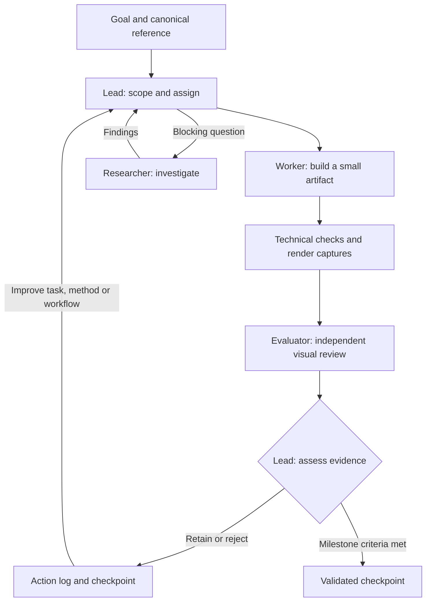

# The ocean — an agentic systems experiment

The main purpose of this project is to build an agentic system with evaluation and feedback loops built in, so it can learn from its results and improve how it works. Generating an ocean inspired by Hokusai’s *The Great Wave* is the test case: a concrete visual problem that exposes weak reasoning, repeated failures and gaps between passing tests and convincing output.

## Agent architecture

A lead coordinates a **worker** for implementation, an independent **evaluator** for visual review, and an optional **researcher** for blocking questions. At most two agents run under the lead, with one source writer.



The loop records failures, compares results with explicit criteria, and changes the next task or method. Repeated failures should trigger a different approach rather than more nearby tweaks. Technical correctness and artistic quality are evaluated separately.

Today, this learning is **lead-managed** through recorded findings and updates to tasks and workflow rules. Reliable autonomous self-improvement is still the goal. See the [agent workflow](agents/wave-completion.md) and [action log](research/agent-iteration-log.md).

## Inspiration

Hokusai’s *The Great Wave* sets the visual direction: a curling silhouette, connected branching foam, flowing indigo contours and carefully shaped negative space. The [Metropolitan Museum scan](references/great-wave-off-kanagawa-met-DP130155.jpg) is the canonical reference for an endlessly explorable ocean in this woodblock language.

[LingDong-’s Shan, Shui](https://github.com/LingDong-/shan-shui-inf) inspires the construction process. It generates an infinitely scrolling Chinese landscape in JavaScript and SVG. A planner places mountains and other objects using noise and spacing rules. Each object is then built from geometry: mountains from nested contours, trees from branching structures, followed by variable-width strokes and texture that follows the surfaces. New regions are generated as the viewer scrolls.

The key idea is **composition → geometry → contours → detail**. Randomness adds variation within that structure. This project applies the same hierarchy to wave profiles, foam branches and water contours, giving the agents a demanding visual task with observable results to evaluate and improve. See the [source study](research/shan-shui-code-notes.md).

## Run locally

No build or package installation is required:

```sh
python3 -m http.server 4187 --bind 127.0.0.1
```

Open the [generated wave gallery](http://127.0.0.1:4187/research/woodblock/generated-gallery.html).
