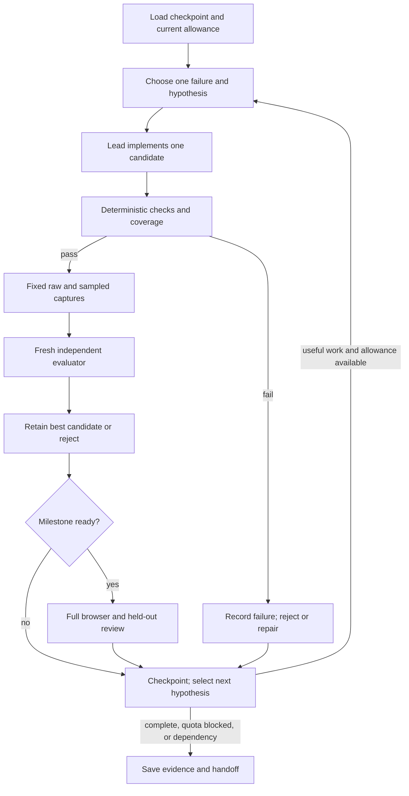

# ADR-001: A quota-aware Codex agent for completing the wave project

**Date:** 2026-10-25  
**Status:** Codex workflow selected by the user; project instructions and roles implemented. Evaluator identity/coverage hardening is verified; calibrated vision and sustained-run validation remain pending.  
**Decider:** Yolanda.  
**Runtime:** Existing Codex session and ChatGPT plan allowance; no separately billed API service.

## Context and decision

Evaluation and loop engineering are the immediate priority. The renderer already passes its technical checks while the generated foam fails the reference-form review. A longer loop with the same weak visual target could spend more allowance producing the same regular hooks. More workers would not resolve that target mismatch.

Use one lead agent for planning, implementation, and integration; one fresh-context evaluator for surviving candidates; and an optional researcher for a named unresolved question. Run mechanical checks in code. Keep one source writer and at most two concurrent subagents. Continue across experiment boundaries without requiring a new “continue” message, while the active Codex run permits it. Preserve a checkpoint before quota/context exhaustion.

The deliverable is an agent workflow that can work toward completion. It cannot guarantee that an unresolved subjective art problem will be solved within one allowance window.

## Research sources and provenance

The requested starting link is a genuine **X Article**, read directly in the browser: [Graph Engineering: build 1000+ agent loops in one window, from one prompt](https://x.com/0xCodila/status/2079597821511020996), codila, July 21, 2026. It recommends separating independent work, fresh verification, isolated writes, and frozen checks, and acknowledges delegation costs. Its profile does not establish employment at a leading AI company. Its large-scale claims are not a sizing recommendation for this project.

Targeted searches did not verify additional native X Articles meeting both the engineer-affiliation and topic requirements. The following are **full articles on official company sites**, not tweets and not claimed to be X-hosted Articles. Their primary pages identify authors or company engineering provenance.

| Article | Verified attribution/date | Application here |
|---|---|---|
| [Harness design for long-running application development](https://www.anthropic.com/research/harness-design-long-running-apps) | Prithvi Rajasekaran, Anthropic Labs; March 24, 2026 | Most relevant: separate generation from evaluation, calibrate subjective judgments, inspect rendered work, and preserve better earlier candidates. Separation alone does not eliminate generous grading. |
| [The Anatomy of Harness Engineering](https://developers.googleblog.com/en/the-anatomy-of-harness-engineering-how-to-evaluate-iterate-and-guard-ai-coding-agents/) | Taylor Mullen, Principal Engineer; Christian Gunderman, Staff Software Engineer; September 9, 2026 | Target observable failure modes with cheap behavioral checks. Retain end-to-end testing; do not require a rigid tool sequence when several paths are valid. |
| [Improved token efficiency for longer agent runs](https://cursor.com/blog/improved-token-efficiency) | Jediah Katz, Connor O’Keefe, Calvin Yee; Cursor research byline, September 23, 2026; individual job titles not provided | Reduce repeated context and tool definitions. Fresh subagent context can help, but duplicated or stale work creates coordination overhead. Cursor removed strong encouragement to delegate exploration. |
| [Effective harnesses for long-running agents](https://www.anthropic.com/research/effective-harnesses-for-long-running-agents) | Justin Young; Anthropic Engineering, November 26, 2025 | Incremental tasks, durable feature status, reproducible setup, and verifiable handoffs across context boundaries. A prompt and compaction alone are insufficient. |
| [How we built our multi-agent research system](https://www.anthropic.com/research/multi-agent-research-system) | Jeremy Hadfield, Barry Zhang, Kenneth Lien, Florian Scholz, Jeremy Fox, Daniel Ford; Anthropic Engineering, June 13, 2025 | Independent research directions suit delegation. Tightly coupled coding often does not. Their research system consumed substantially more tokens; this is not a universal multiplier for our project. |
| [Harness engineering: leveraging Codex in an agent-first world](https://openai.com/index/harness-engineering/) | Ryan Lopopolo, Member of the Technical Staff; February 11, 2026 | Keep repository knowledge accessible and versioned. Use a short instruction map pointing to task-specific evidence, rather than injecting the whole research history each turn. |

Supporting implementation references: [Codex subagents](https://learn.chatgpt.com/docs/agent-configuration/subagents), [Codex SDK](https://learn.chatgpt.com/docs/codex-sdk), and [non-interactive mode](https://learn.chatgpt.com/docs/non-interactive-mode). These document project-scoped TOML agents, inherited permissions, and programmatic execution. Native role instructions do not create a separate read-only sandbox. JSON usage events are useful for a future runner, but turn-end reporting alone is not a hard aggregate token cap. [OpenAI's traced improvement-loop cookbook](https://developers.openai.com/cookbook/examples/agents_sdk/agent_improvement_loop) provides a useful feedback-to-regression-test pattern; this project does not need its financial-agent stack.

These are engineering reports, not guarantees. In particular, more evaluation is worthwhile only when its verdict is aligned with the actual artistic goal.

## Process audit before hardening

Current source and canonical reference match the recorded October 12 receipt. Its status remains `expected=pass`, `form=needs_work`, `quality=pending`. Seven existing Node tests passed in a fresh read-only audit on October 25, in approximately 135 ms. The browser was not rebenchmarked for this audit.

| Cost or activity | Evidence and interpretation |
|---|---|
| Node model checks | Fresh audit: seven tests, about 0.14 s. Cheap; do not replace them with LLM reviewers. |
| Browser renderer stage | Recorded receipt: 3.537 s, including 120 animation-frame intervals. Excludes subsequent phase checks, galleries, and visual review. |
| Tile generation | Recorded median 3.7 ms, p95 7.6 ms in one browser. Not a GPU/process-memory or cross-browser measurement. |
| Context loading, reasoning, screenshot review, repeated failed revisions | Likely major model costs, inferred from the workflow. No per-stage LLM token or spend telemetry currently establishes their exact ranking. |
| Thirty scene views plus six-fixture phase analysis on every revision | Useful milestone coverage, but excessive for some local changes. Split focused checks from the full acceptance run. Total pipeline wall time remains unmeasured. |
| Extra agents | Can shorten independent research and isolate noisy context. Can also repeat reads, consume more quota, and create write conflicts. No project-specific savings benchmark exists. |

The expensive failure is repeatedly improving an easy metric while the art remains wrong. Cost should be measured as allowance/tokens and elapsed time per **verified useful improvement**, alongside regression and evaluator error rates—not number of workers or iterations.

### What works

- Canonical image pin, app fingerprint, immutable source snapshots, and stale-source rejection.
- Independent expected-output, original-form, and quality gates; no beauty average hiding a failed form.
- Fixed seeds, raw-versus-sampled evidence, water occlusion, regeneration, and retained-cache checks.
- Preserved failing fixtures and explicit acknowledgement that numerical topology is not visual fidelity.

### What does not yet support sustained autonomy

1. **Evaluator drift:** `scripts/validate.mjs` hashes app source, not the tests, rubric, crop/render protocol, and fixture definitions. The browser restores reviews using app/reference hashes only. A changed evaluator can inherit an old verdict.
2. **Missing cases can look successful:** `crest-phase-checks.mjs` silently skips absent curl fixtures. Empty channel metadata produces no failing probes. Assert fixture identities/counts and phase coverage; zero evidence must fail completeness.
3. **Changed denominators:** the thirteen-group construction tested 1,152 probes of each type; five groups test 384. Preserve the useful openness result, but do not mistake fewer opportunities to fail for proof of artistic progress. Allow structural redesign only with an explicit new coverage map.
4. **Self-review:** the current UI accepts a reviewer string plus pass selections and evidence text. It does not distinguish independent evaluation from user acceptance or bind the review to hashed images.
5. **Uncalibrated visual target:** no accepted semantic foam mask or human-labeled positive generated crest exists. A full-print pixel score would reward paper, boats, and fixed composition that are outside the requested ocean.
6. **Loop stagnation:** straight coves, repeated hooks, smooth cap, weak secondary branches, and a detached sampled fragment remain. A successful test run does not justify moving on to composition.

Evidence: [validation runner](../scripts/validate.mjs), [browser loop](tests/validation-loop.mjs), [phase checks](tests/crest-phase-checks.mjs), [October 12 receipt](output/validation-hierarchical-lobes.json), [iteration findings](hierarchical-lobes-iteration.md).

## Evaluation and loop design

### 1. Establish a stable evaluation contract

Bind every result to app hash, canonical image hash, evaluator/test/rubric version, fixture manifest, crop/viewport/DPR protocol, and captured-image hashes. Bind model-based reviews additionally to reviewer model/prompt and comparison identity. Distinguish test-evidence freshness from visual-review freshness.

Initially retain the six recorded curl fixture IDs and sixteen offsets each. Preserve semantic coverage when branch count changes rather than requiring every candidate to have the same number of fingers. Missing fixtures, empty probes, stale captures, or unsupported review inputs yield `incomplete`, never a pass.

Frozen evaluator files are protected by the parent workflow's policy in this Codex version; they are not technically immutable to a process with shared write permissions. A later enforced controller should own evaluation inputs outside the candidate's writable scope. Do not present hashing alone as tamper-proofing.

### 2. Calibrate judgment before optimizing it

Use canonical foam crops and the retained weak outputs as negative calibration material. Obtain human labels for a small set of positive/negative comparisons, including connected roots, branching hierarchy, open hollows, and legibility at actual size. A complete foam trace may help the reference study; whole-image pixel similarity is unsuitable for procedural variations.

Require the evaluator to locate a visible defect, admit uncertainty, and distinguish missing evidence from success. Use blinded A/B labels and vary comparison order. Reject the evaluator if it promotes the known weak fringe solely because its probes pass. Keep final artistic acceptance separate from provisional evaluator judgments.

### 3. Run a staged candidate loop

The graph is intentionally small. The candidate implementation and its evaluation depend on each other; they cannot be parallelized honestly. Reference research or a separate regression investigation may run alongside independent work. Numerical tests and fixture rendering are jobs for code, not one LLM per seed.

After three rejected attempts on one failure, require a bounded diagnosis and a different hypothesis before another edit. Keep the best verified version. Do not mechanically select the final iteration. Retain required non-regression gates and known visual failures when an experiment changes representation.

### 4. Use evidence progressively

Run deterministic checks on each candidate. Produce focused raw/sampled contact sheets and JSON summaries before calling a visual reviewer. Unchanged renderer evidence may be reused only when its exact code and protocol dependencies are unchanged. At milestone candidates, run the full suite and held-out seeds, middle layers, desktop sizes/DPR values, actual pause/manual/reduced-motion interactions, and longer travel.

The current all-in-one validation page needs focused modes and a scriptable capture/export path before this is fully automated. It must remain possible to inspect artifacts directly in Codex's browser/image tools. Do not assume a separate CLI process inherits this chat's browser session or tools.

## Plan allowance and persistence

The user selected **whatever allowance remains in the ChatGPT plan**, not a numeric token allocation. Account usage windows are shared across chats and models; reported percentages cannot be converted into a reliable remaining-token count. Native Codex enforces its own allowance. Project prompts cannot guarantee exact budget enforcement or operation after the host stops the session.

Read available usage at startup, before new fan-out, and at milestones. At 10% or less in either window, save the checkpoint, stop launching new parallel work, and favor finishing a bounded check. This reserve is a workflow policy, not a provider-guaranteed stop threshold. On quota refusal, stop retries and leave a resumable handoff. Do not buy credits, redeem resets, use paid API fallback, or schedule a restart implicitly.

Token accounting, when available, must cover lead, workers, research, retries, and judges. Count reported input/output once; cached input and reasoning counters may be subsets, not additions. Do not add child totals to a parent rollup that already includes them. Report unavailable attribution honestly. Account percentages are adequate for quota awareness, not for proving token savings.

No daemon, timed automation, or independent service has been started. The instructions keep an active authorized session working across milestones; they cannot keep Codex running after the process ends. `research/agent-state.json` is the durable project checkpoint and must be refreshed when work begins.

## Options considered and consequences

| Option | Complexity / cost | Assessment |
|---|---|---|
| One longer prompt, no independent review | Low setup, weak feedback | Retains the current tendency to produce technically correct but visually weak iterations. |
| Small Codex team and versioned staged evaluation | Moderate setup; current plan allowance | **Selected.** Reuses working tools, isolates review, limits duplicated context. Prompt rules are not hard process isolation. |
| Standalone SDK/controller with per-call accounting | Higher implementation/operations cost; billing and browser integration need explicit decisions | Deferred. Appropriate only if measured needs require enforceable external scheduling/accounting. Do not build it solely to imitate an agent loop Codex already provides. |
| Broad swarm of parallel geometry writers | High coordination and integration overhead | Rejected for the current tightly coupled crest implementation. Parallel candidates need isolated snapshots and controlled integration, not simultaneous edits to `src/crest.mjs`. |

The checkout currently has untracked project files. A new Git worktree alone would not carry those files. Establish a recoverable complete baseline or verified copy before using isolated candidate workspaces; do not reset or discard the existing checkout.

## Implementation status and next work

Implemented: separate evaluator fingerprint/snapshot, render-protocol review identity, stale-evaluator rejection, fixed-fixture/phase/channel completeness assertions, and targeted regression tests. Also implemented [lead instructions](../agents/wave-completion.md), project-scoped evaluator/researcher TOML roles, a two-subagent configuration, an `AGENTS.md` route, and [persistent project state](agent-state.json). TOML parsing and a fresh-context evaluator smoke test validate parts of this setup; they do not prove native role discovery, sustained unattended operation, or calibrated artistic acceptance.

Action order:

1. H1–H2 **complete for the present protocol**: eleven model tests and the refreshed browser suite pass. An already-open evaluator rejected changed inputs and disabled export. The [smoke receipt](output/agent-harness-smoke.json) records the test and its limits. Evidence-image binding and authenticated review remain incomplete, not implicitly solved by hashing evaluator files.
2. H3: add focused validation/capture modes and compact evidence summaries; measure full run time and model usage when exposed.
3. H4: calibrate independent visual judgment, then run a short pilot against the retained failing crest. Measure accepted improvements and regressions before broadening delegation.
4. W1–W4: refine and accept crest, then distinct breaker/band forms, ocean composition, and actual desktop behavior. Continue with checkpoints while allowance permits.

The setup and first hardening stage are complete enough to begin the focused-capture pilot. The art project remains incomplete, and its completion cannot be inferred from this agent configuration.

## Mixed-model routing — 2026-10-25

The project now preserves the chat-selected lead model (Astra when selected), explicitly routes bounded research to Luna/high, bounded implementation to Sol/medium, and independent evaluation to Sol/high. Unnamed children default to Luna/high. Role files override model inheritance; the lead picker is not changed. Configuration and fallback details are in [the setup guide](../agents/README.md).

Named researcher/evaluator tasks and an explicit Sol/medium worker fallback completed bounded smoke checks. The newly added named worker still needs discovery in a refreshed session. All eleven model tests pass; no independent provider billing attribution or parent-Astra run was inspected. [Routing smoke evidence](output/agent-routing-smoke.json). The evaluator configuration change invalidates previous browser/visual review identity; rerun the browser stage before treating evidence as current.

## Execution update — 2026-10-26

Named worker, researcher and evaluator roles have now completed bounded work in this session. Focused native captures, byte-level PNG identities, positive/negative human calibration labels, fixed-phase connectivity and principal-cove openness checks are implemented. Current evidence and unresolved art failures are linked in `validation-report.md`; configuration success does not establish artistic completion or measured token savings.

The user delegated routine design choices to the lead and requested lean agents. Completion instructions, the agent README and three role definitions were reduced from 1,904 to 1,053 words. Model and concurrency settings remain in `.codex/`; the state file now points there instead of duplicating routing. No additional role or framework was introduced. The recurring bottleneck remains generating reference-faithful branching, followed by reading and judging its native sampled output; more orchestration does not solve that geometry problem.
